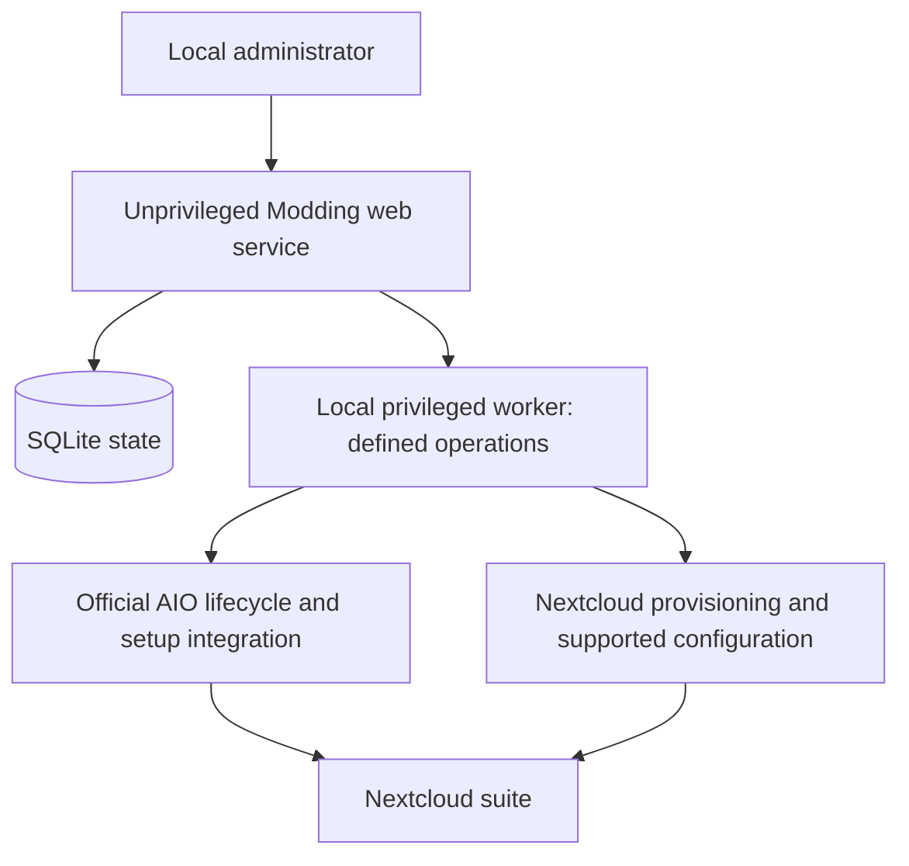

# Approved design

Approved through the project design interview on 2026-11-01, including the
clarification that establishment selection happens during installation and AIO
already works for the user. This document records requirements, not a claim of
implemented Modding functionality. Modding's runtime checks remain pending in
[the validation plan](validation.md).

## Product and scope

Modding delivers APS Conecta Gestión as an installation and administration layer
around official Nextcloud AIO. Its installer and provisioning core are
establishment-agnostic. One fresh, dedicated server serves one establishment
chosen by the operator during installation. The suite excludes patient data.
Setup and administration are Spanish-facing, with Chilean locale defaults and
formal usted.

Version one targets Ubuntu Server 24.04 LTS and Debian 13 on x86-64. These are
selected test targets, not yet certified platforms. ARM, other distributions,
offline installation, adoption of existing Nextcloud instances and migration
from `gestion` are outside version one. Required resources will be measured for
the selected app set before a release declares minimum hardware requirements.

The project preserves the intended functions of `gestion`, subject to explicit
compatibility verification. It uses configuration, provisioning interfaces and
separately installed extensions. Official Nextcloud/AIO images and their source
files remain unmodified. A feature that needs an upstream patch returns for a
scope decision; it is not silently implemented as a container-file edit.

## Delivery and installation

An HTTPS shell bootstrap, usable through `curl … | sh`, installs a signed,
versioned Modding release. There is no `.deb`. Installation downloads dependencies,
official container images and selected apps; it is not a self-contained offline
bundle. The bootstrap verifies the release payload before installing it and
fails if verification fails. Trust in the initial bootstrap comes from its HTTPS
distribution source; a signed payload does not independently authenticate code
already executed in that bootstrap.

Preflight validates the platform, storage, ports, connectivity and required host
capabilities before making installation changes. It reports unsupported or
conflicting state instead of replacing an existing deployment. The exact host
requirements and release-signing mechanism must be established during implementation.

The wizard collects establishment choices, checks prerequisites, previews the
configuration and reports progress through provisioning. Saved progress supports
resumption after interruption. Each retry checks actual state before acting;
completed users and data are preserved. Ambiguous outcomes require inspection
and actionable recovery instructions rather than destructive reinitialization.

Fully automatic first setup depends on AIO's internal authenticated endpoints.
This integration must be isolated behind an adapter and covered by version-specific
tests when implemented. The inspected upstream documentation does not establish
a stable public API for first setup. AIO's existing operation is the accepted
base; implementing the configuration wizard does not wait for a separate AIO
feasibility prototype. The adapter still needs validation before release.

## Network, hostname and certificates

The initial wizard is reachable through the server IP. The IP entry page directs
users to the suite's hostname; the browser then uses that hostname. Permanent
`https://192.168.x.x` suite URLs are not part of this design.

Production requires an institution-controlled domain, local DNS resolution for
the hostname, and a publicly trusted certificate obtained through DNS
verification with automated renewal. Clients and containers must resolve and
reach the intended service. The reverse-proxy route follows upstream AIO guidance;
the particular proxy and supported DNS-provider integrations remain implementation
choices subject to tests. No public inbound access to Nextcloud is required.

The default deployment serves users over the LAN or VPN. The host and containers
need direct outbound HTTPS access plus the network services needed for DNS,
certificate issuance and configured mail delivery. Environments that require an
authenticated outbound proxy are deferred until separately proven. Configuring
Docker's image-pull proxy alone does not establish support for all containers.

Protect the IP setup interface and its credentials in transit. Its bootstrap TLS
and trust procedure must be documented and tested before release; final-suite
hostname TLS alone does not prove that the initial IP setup session is protected.

## Establishment configuration and accounts

Require the operator to choose or define the establishment before provisioning.
Capture its identity in the installation configuration; never bake a real
establishment name, identifier, roster or organizational structure into the
installer. Keep one establishment per installation.

Offer an establishment catalog when available and allow manual definition when
the desired establishment is absent. A DEIS identifier is optional metadata,
not a prerequisite for using the installer. Catalog records and organizational
templates are data; the core must not depend on a particular establishment or
registry entry.

Use `gestion`'s sectors, programs, groups, shared folders and group-based
permissions as editable starting templates. The operator chooses the applicable
structure during installation; no specific template is mandatory. Show the
selected identity, resulting structure and permissions before applying them.
Persist the approved choices and use that configuration for provisioning and
recovery.

Create one named initial administrator and import named staff from a validated,
previewed CSV. The planned fields cover names, usernames, email addresses, groups
and optional quotas; finalize the schema and examples with the implementation.
Represent positions such as director through groups assigned to named people,
rather than automatically creating shared position accounts.

Production setup requires a working SMTP service. Verify mail delivery before
reporting account invitations complete. Send password-setup invitations after
approval of the import. Do not distribute a roster of initial passwords or claim
that a native temporary password enforces a first-login change.

Apply defaults once. Subsequent reconciliation previews proposed changes and
preserves direct administrator edits until an explicit change is approved.
Missing CSV rows do not automatically delete accounts. A rerun does not reset
passwords. Permission changes need the same explicit review as other changes.

## Branding and applications

Use supported Nextcloud theming settings for name, colors, logos, background and
links. Give the separate Modding installer and administration frontend the APS
identity. Extensive changes to Nextcloud's internal layouts are deferred.

Use original upstream releases for third-party apps, including
[IntraVox](https://github.com/nextcloud/IntraVox) and
[Files Full Text Search](https://github.com/nextcloud/files_fulltextsearch), instead
of the APS derivatives selected by `gestion`. APS-authored apps remain separate
extensions. Original-upstream replacements must be checked for required behavior;
equivalence with modified apps has not been established.

The [existing catalog](https://github.com/APS-Conecta/gestion/blob/main/apps.json)
provides the functional checklist:

| Selection | Intended functions/apps |
| --- | --- |
| Included | IntraVox home/news; Group Folders; EuroOffice; Calendar; Contacts; Epidemiología; Territorio; Talk; Client Push; Fulltextsearch with Elasticsearch connector; Files Full Text Search; Files Upload Guard; Antivirus; Custom Menu |
| Optional, initially off | Estadística; Farmacia; Tótem |

Verify app identifiers, original sources, versions, dependencies and licensing
when building the actual manifest. Required apps block successful completion if
installation or compatibility checks fail. Preserve working components while
reporting the failure. A selected optional app may be omitted only through an
explicit operator decision.

Use AIO's integrated EuroOffice where supported by the selected release. Upstream
v14.4.3 already defaults fresh installations to EuroOffice; an external office
service is not required merely to preserve that product choice.

## Architecture and authority

Use Go for the backend, an embedded server-rendered frontend with lightweight
JavaScript, SQLite for installation state, and systemd service management.
Detailed libraries and UI layout are implementation choices within this design.

The frontend submits defined operations and displays progress. The worker exposes
a narrow local interface with authorization and argument validation; the browser
cannot submit arbitrary shell commands. Docker-socket access is privileged and
belongs behind this boundary. Implementation must specify IPC authorization,
service identities, filesystem permissions and secret storage.

Keep administration accessible only through the LAN or VPN by default. Print a
one-time setup credential in the local terminal, then require a separate Modding
administrator login. Protect session state and redact secrets from logs. An
authorized root operator can recover Modding access through a local command
that creates a short-lived credential, invalidates existing administration
sessions and records the event without recording the credential itself.

## Updates, backups and ownership

Modding owns its frontend/backend, establishment configuration and provisioning
workflow. AIO owns its container lifecycle and integrated-service configuration.
Map app/configuration ownership before implementation because AIO may rewrite
integrated settings and update apps at startup. Modding must not continually
fight those settings with a second automatic configuration loop.

Updates require administrator-approved maintenance windows, compatibility checks
and a pre-update backup. AIO performs its container updates. Approval authorizes
an upstream stable-channel update; it does not guarantee an exact frozen image
set. AIO pulls moving tags, so a checked tag may change before download. Record
actual versions and digests, run post-update checks and report mismatches. Image
rollback alone is not a recovery plan after database migrations.

Provide a separate explicit Modding upgrade command and matching UI action.
Verify its release payload, back up its state and handle configuration/database
migrations. Updating AIO containers or apps is not a substitute for upgrading
the installed Modding service.

Production setup requires a configured backup destination and a successful first
backup. Production go-live also requires a copy outside the installation host
and a documented restore rehearsal. A clearly marked evaluation mode permits
backup deferral; it must not be presented as production-ready.

Guided recovery restores both the AIO instance and Modding's own configuration,
state database and credentials. AIO's additional-directory backup support does
not imply those directories are restored by its standard instance restore;
Modding needs a coordinated recovery step. Keep the backup encryption password
and remote-storage access material available independently of the failed host
and its encrypted backup. Restore a consistent pre-upgrade state when necessary;
Nextcloud does not support downgrading an upgraded installation.

Each establishment nominates a technical administrator for updates, failed
backups and account recovery. APS maintains Modding releases and compatibility
guidance. Version one operates without an APS central management service.

## Proof and documentation

The first milestone implements the Modding configuration wizard: establishment
selection or manual definition, editable organizational configuration, validation,
SQLite persistence and a provisioning preview. Demonstrate that two different
synthetic establishments can use the same build without shared identity or
configuration leaking between installations. Provisioning requires an explicit
establishment selection and confirmation of the preview.

Then connect the saved configuration to the worker for users, branding and the
approved app catalog, and integrate the AIO installation path. AIO is the working
base reported by the user; the work proves Modding's behavior and integration.
End-to-end installation and recovery on disposable servers remain release gates,
rather than a separate upstream feasibility milestone before wizard development.

The [validation plan](validation.md) defines those gates and documents current
upstream constraints. A failed required capability returns for an explicit
decision; it does not authorize an upstream patch, silent omission or success claim.

Keep documentation current through the workflow in [CONTRIBUTING.md](../CONTRIBUTING.md).
Runnable operator instructions and release claims must follow demonstrated
behavior. The current document authorizes a design, not a claim that the installer
or its integrations already work.
