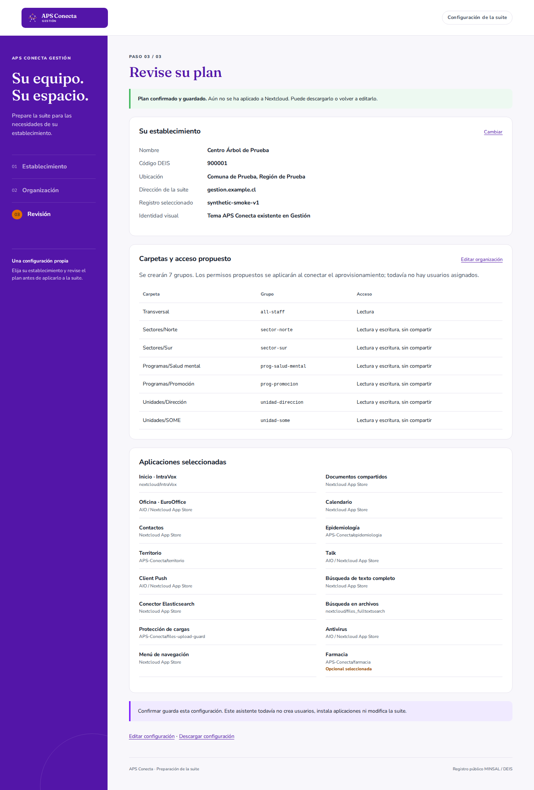
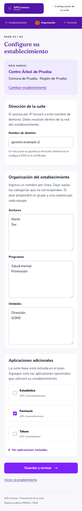

# Configuration wizard milestone: 2026-11-02

## Environment and scope

Verification ran in a detached Git worktree on Ubuntu 24.04.5 LTS, x86-64, using
Go 1.27.3, SQLite driver `modernc.org/sqlite` v1.61.1, Playwright 1.64.1 and Chromium
156.0.8078.4. The source manifest pins Gestión imports to
`a09641015d1bbc7e999129795ec60c1aa96f2e54`. The bundled DEIS snapshot is dated
2026-07-23 and contains 2,655 records. Browser scenarios use only the synthetic
establishments in [the fixture](../../tests/fixtures/establishments.csv).

This evidence applies to the first configuration wizard implementation and its
PR commit. It does not validate AIO installation, Nextcloud app compatibility,
the full server theme, Debian 13 or production recovery.

## Results

| Check | Result |
| --- | --- |
| `go test -race ./...` | Passed: catalog validation/search; organization/domain/app validation; concurrent state edits and restart; request protections; selection, confirmation/export, isolation and catalog-change review |
| `go vet ./...` | Passed |
| `go build -o bin/modding ./cmd/modding` | Passed |
| `python3 scripts/check_sources.py` | Passed: 10 imported files match recorded hashes |
| `python3 scripts/check_docs.py` | Passed for authored Markdown; immutable imported brand mapping retains its upstream-relative references |
| `python3 tests/browser_smoke.py --binary ./bin/modding` | Passed: real browser selection, organization/app choices, preview, confirmation, JSON export, persistence across restart over TLS, secure cookies and changing establishments |
| Browser layout and resources | Desktop 1440 px and mobile 390 px; no page overflow, missing assets or JavaScript errors in the smoke flow |
| LAN plaintext listener | Refused before listening; non-loopback access requires TLS credentials |

The browser test exposed an opaque `Origin` on form submission under
`Referrer-Policy: no-referrer`. The policy now uses `same-origin`, and the full
browser flow passes while foreign and opaque origins remain rejected by tests.
Visual inspection also caught a white logo placed on white; the original logo
now appears on the APS violet background without modifying its imported bytes.

The TLS restart test uses an ephemeral self-signed fixture and deliberately
accepts that fixture in its browser context. It proves transport/cookie behavior,
not production certificate issuance or client trust.

## Screenshots

Desktop review with a synthetic establishment:

Mobile organization configuration with the same synthetic establishment:

## Remaining work

- Add the privileged worker and connect the confirmed plan to provisioning.
- Implement roster import, SMTP verification, user creation and detailed permission review.
- Install and validate the existing theme inside unmodified upstream Nextcloud.
- Validate and install original upstream apps and APS-specific extensions.
- Implement the shell bootstrap, AIO setup adapter and automatic certificate workflow.
- Implement persistent administration accounts, recovery, updates and coordinated backups.
- Run the full supported-platform and suite acceptance matrix before a production release.
